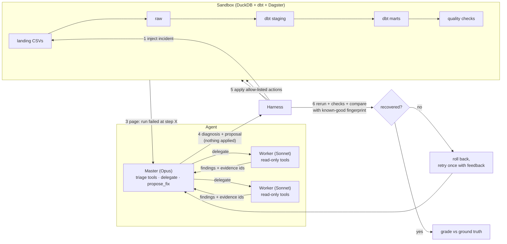

# Architecture

## The loop

The agent investigates and decides. The harness acts and judges. Those two jobs never mix.

## Components

| Layer | Code | Responsibility |
|---|---|---|
| Model access | `llm/claude_cli.py` | Stateless `claude -p` calls on the owner's subscription: custom system prompt, built-in tools off, settings isolated, `ANTHROPIC_API_KEY` stripped, stream-json in/out (text + images), JSON-schema output, token/cost accounting. |
| Sandbox | `sandbox/` | Deterministic synthetic shop data, by-name ingest contract, dbt project copy, Dagster job (one process per run), DQ checks, snapshot/restore, fingerprints. |
| Upstream simulator | `sandbox/upstream.py` | Persistent export changes vs one-off glitches, so "ask upstream to resend" is only a real fix for the latter. |
| Incidents | `incidents/catalog.py`, `harness.py` | 24 incidents with ground truth, true fixes and decoy fixes; a gate that proves each claim. |
| Remediation | `sandbox/remediation.py` | The only way to change the sandbox: 8 narrow, validated actions. |
| Verification | `sandbox/verify.py` | recovered ⇔ rerun succeeds ∧ every check passes ∧ every table equals the clean run's fingerprint. |
| Tools | `tools/investigate.py`, `registry.py` | 11 read-only tools returning evidence ids; roles; `delegate`; `propose_fix` (validates, applies nothing); the trace. |
| Tool transport | `tools/mcp_server.py` | One MCP server process per agent session; the role decides which tools exist. |
| Agent | `agent/` | Master and worker prompts, diagnosis schema, delegation, the episode loop with verification and one retry. |
| Evaluation | `eval/report.py` | Metrics with Wilson intervals, per config and incident set. |
| Dashboard | `dashboard/` | Static replay of recorded traces; no model or sandbox access. |

## Trust boundaries

1. **The model never touches state.** Every investigation tool is read-only by construction: DuckDB opens
   `read_only` with external access disabled, SQL is single-statement SELECT only, and no tool can reach the
   simulator's internals (upstream change list, snapshots, catalog, reference fingerprints).
2. **Workers cannot remediate.** A worker is a separate process whose MCP server doesn't list `propose_fix` and
   refuses it by role; the CLI's `--allowedTools` list is a second fence. A live check confirmed a worker told
   to call it couldn't.
3. **Proposals must cite what was seen.** `propose_fix` rejects evidence ids that no tool returned in the same
   investigation.
4. **Success is measured, not reported.** The harness applies the proposal, reruns, and compares every table with
   a known-good run. A failed fix is rolled back before the retry.

## Why these choices

- **Claude Code CLI instead of the API.** The project runs on a subscription. The cost metric is therefore an
  API-equivalent estimate computed from tokens, and evals are sized to the plan's usage limits.
- **Separate worker processes instead of in-session subagents.** Each worker gets its own tool server in a
  read-only role, so the permission boundary is enforced by code, and its usage lands in the trace as its own call.
- **A triage-only master.** When the master had every tool, it never delegated (v1 dev runs). With triage tools
  only, detailed reading moves to Sonnet workers. Whether that is worth it is measured, not assumed (Phase 6 ablations).
- **One process per pipeline run.** dbt-duckdb holds the warehouse file open for the life of the process, which blocked
  snapshots on Windows. A child process releases every handle (cost: ~20 s per run).
- **Fingerprint comparison, not just checks.** Checks can be satisfied by destroying data. A content hash of every
  table against a clean run cannot.
